# ambientCG: Planks materials

**26 assets from [ambientCG](https://ambientcg.com), dedicated to the public domain under [CC0](https://docs.ambientcg.com/license/).** Use them in any game, free or paid, and change them however you like; no credit is needed.

PBR materials as 1K and 2K JPG maps (colour, normal GL and DX, roughness, AO, displacement), one folder per resolution. 887.8 MB in all.

This is a copy kept by [zuujis-cc0](https://github.com/zuujis-cc0) so game makers can take single files from GitHub. It is not made by or affiliated with ambientCG: the originals, often in more formats and higher resolutions, are on [ambientcg.com](https://ambientcg.com). If they help you, consider [supporting ambientCG](https://www.patreon.com/ambientCG).

Every file is listed in [MANIFEST.tsv](MANIFEST.tsv) with its size and SHA-256. More free assets: [the Zuujis collection](https://github.com/zuujis-cc0/free-game-assets#readme).

| | | | |
| :-: | :-: | :-: | :-: |
| <a href="Planks024A">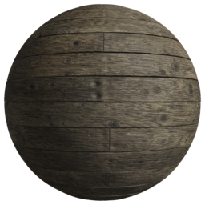</a> <b><a href="Planks024A">Planks 024 A</a></b> by ambientCG · <a href="https://ambientcg.com/a/Planks024A">source</a> | <a href="Planks024B">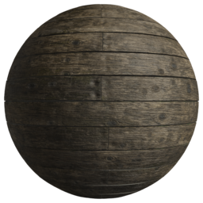</a> <b><a href="Planks024B">Planks 024 B</a></b> by ambientCG · <a href="https://ambientcg.com/a/Planks024B">source</a> | <a href="Planks024C">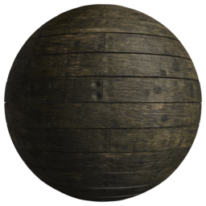</a> <b><a href="Planks024C">Planks 024 C</a></b> by ambientCG · <a href="https://ambientcg.com/a/Planks024C">source</a> | <a href="Planks025A">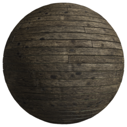</a> <b><a href="Planks025A">Planks 025 A</a></b> by ambientCG · <a href="https://ambientcg.com/a/Planks025A">source</a> |
|  <b><a href="Planks025B">Planks 025 B</a></b> by ambientCG · <a href="https://ambientcg.com/a/Planks025B">source</a> | <a href="Planks025C">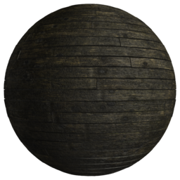</a> <b><a href="Planks025C">Planks 025 C</a></b> by ambientCG · <a href="https://ambientcg.com/a/Planks025C">source</a> | <a href="Planks026A">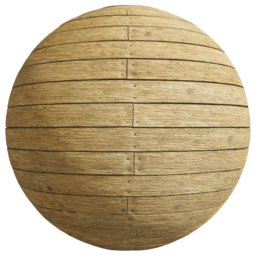</a> <b><a href="Planks026A">Planks 026 A</a></b> by ambientCG · <a href="https://ambientcg.com/a/Planks026A">source</a> | <a href="Planks026B">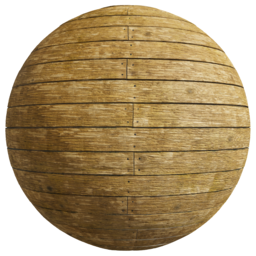</a> <b><a href="Planks026B">Planks 026 B</a></b> by ambientCG · <a href="https://ambientcg.com/a/Planks026B">source</a> |
| <a href="Planks026C">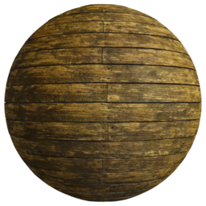</a> <b><a href="Planks026C">Planks 026 C</a></b> by ambientCG · <a href="https://ambientcg.com/a/Planks026C">source</a> | <a href="Planks027A">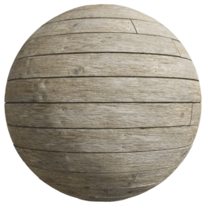</a> <b><a href="Planks027A">Planks 027 A</a></b> by ambientCG · <a href="https://ambientcg.com/a/Planks027A">source</a> | <a href="Planks027B">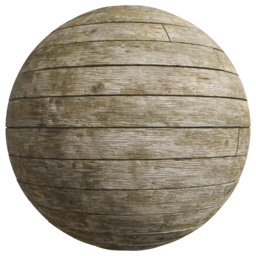</a> <b><a href="Planks027B">Planks 027 B</a></b> by ambientCG · <a href="https://ambientcg.com/a/Planks027B">source</a> | <a href="Planks027C">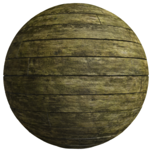</a> <b><a href="Planks027C">Planks 027 C</a></b> by ambientCG · <a href="https://ambientcg.com/a/Planks027C">source</a> |
| <a href="Planks028">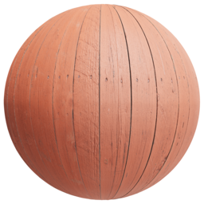</a> <b><a href="Planks028">Planks 028</a></b> by ambientCG · <a href="https://ambientcg.com/a/Planks028">source</a> | <a href="Planks029L">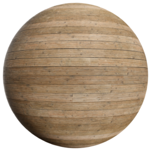</a> <b><a href="Planks029L">Planks 029 L</a></b> by ambientCG · <a href="https://ambientcg.com/a/Planks029L">source</a> | <a href="Planks029S">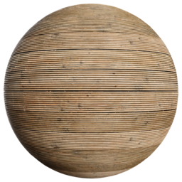</a> <b><a href="Planks029S">Planks 029 S</a></b> by ambientCG · <a href="https://ambientcg.com/a/Planks029S">source</a> | <a href="Planks030A">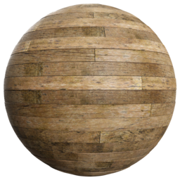</a> <b><a href="Planks030A">Planks 030 A</a></b> by ambientCG · <a href="https://ambientcg.com/a/Planks030A">source</a> |
| <a href="Planks030B">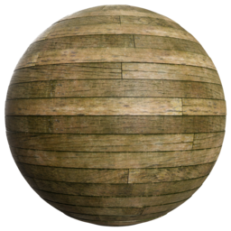</a> <b><a href="Planks030B">Planks 030 B</a></b> by ambientCG · <a href="https://ambientcg.com/a/Planks030B">source</a> | <a href="Planks030C">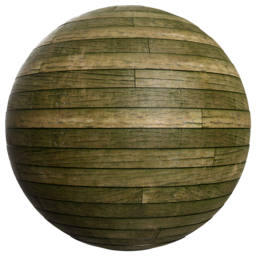</a> <b><a href="Planks030C">Planks 030 C</a></b> by ambientCG · <a href="https://ambientcg.com/a/Planks030C">source</a> | <a href="Planks031A">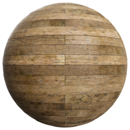</a> <b><a href="Planks031A">Planks 031 A</a></b> by ambientCG · <a href="https://ambientcg.com/a/Planks031A">source</a> | <a href="Planks031B">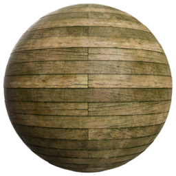</a> <b><a href="Planks031B">Planks 031 B</a></b> by ambientCG · <a href="https://ambientcg.com/a/Planks031B">source</a> |
| <a href="Planks031C">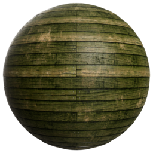</a> <b><a href="Planks031C">Planks 031 C</a></b> by ambientCG · <a href="https://ambientcg.com/a/Planks031C">source</a> | <a href="Planks032">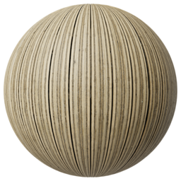</a> <b><a href="Planks032">Planks 032</a></b> by ambientCG · <a href="https://ambientcg.com/a/Planks032">source</a> |  <b><a href="Planks033A">Planks 033 A</a></b> by ambientCG · <a href="https://ambientcg.com/a/Planks033A">source</a> | <a href="Planks033B">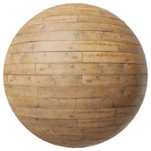</a> <b><a href="Planks033B">Planks 033 B</a></b> by ambientCG · <a href="https://ambientcg.com/a/Planks033B">source</a> |
|  <b><a href="Planks034A">Planks 034 A</a></b> by ambientCG · <a href="https://ambientcg.com/a/Planks034A">source</a> | <a href="Planks034B">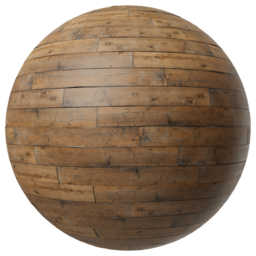</a> <b><a href="Planks034B">Planks 034 B</a></b> by ambientCG · <a href="https://ambientcg.com/a/Planks034B">source</a> |  |  |

---

Kept up to date by this repository's own [update workflow](.github/workflows/update.yml), with code and plan from [cc0-mirror](https://github.com/zuujis-cc0/cc0-mirror). Something wrong? [Open an issue there](https://github.com/zuujis-cc0/cc0-mirror/issues/new) or use the [private report form](https://games.zuujis.com/report).
